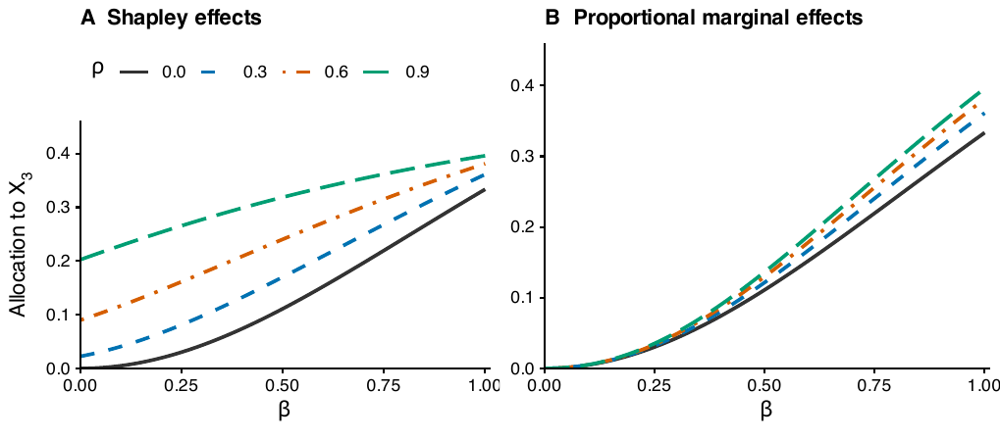

# PRIME: A New Measure for Variable Importance

[Paper](https://arxiv.org/abs/2610.17053) · [Code and results](https://github.com/ChoYoungSeo/prime-importance-paper) · [Python package](https://github.com/ChoYoungSeo/prime-importance)

## Why PRIME?

PRIME measures which inputs explain a response and how much each contributes, even when observations are noisy and inputs are correlated. It estimates **proportional marginal effects (PME)**: under the paper's identifiability conditions, redundant inputs receive zero population importance. This addresses a limitation of Shapley effects, which can give substantial credit to correlated proxies.

<p align="center"></p>

**A correlated proxy.** In **m(X) = X₁ + X₂ + βX₃**, the inputs are jointly Gaussian with standard-normal marginals; X₁ and X₃ have correlation ρ with |ρ| < 1, and X₂ is independent. At β = 0, the regression mean does not depend on X₃: its Shapley effect is ρ²/4, while its PME is zero.

PRIME estimates these signal contributions from observed data, assigning zero outside the selected set. The paper establishes consistency under its estimation and selection conditions; restricting allocation to selected inputs also reduces the cost of exact computation.

## Results

**Friedman.** Five active inputs and five correlated proxies. PRIME has the lowest mean PME estimation error among PRIME, PRIME-Full, and PME-NA across all nine sample-size and correlation settings in Table 2. The plot shows 30 paired datasets with n = 100 and ρ = 0.9; PME-NA denotes noise-adjusted PME-kNN with six neighbors, and FIRST-SHAP and mean absolute SHAP provide Shapley-based comparisons. Mean absolute SHAP is shown in response units.

<p align="center"></p>

**Concrete strength.** Across 100 repeated samples of 824 observations, PRIME gives concentrated importance to the water-to-binder ratio and age. All four methods use the same observations; mean absolute SHAP summarizes a fitted boosted-tree model.

<p align="center"></p>

## Install

Requires R 4.2 or newer and a C++ toolchain.

Install from the R repository:

```r
install.packages("remotes", repos = "https://cloud.r-project.org")
remotes::install_github("ChoYoungSeo/prime-importance-r", upgrade = "never")
```

Alternatively, from the root of a local checkout:

```r
remotes::install_local(".", upgrade = "never")
```

The R package is `prime` (version `0.5.5`).

## Quick start

```r
library(prime)

set.seed(5)
X <- matrix(runif(300 * 8, -1, 1), nrow = 300)
colnames(X) <- paste0("X", seq_len(ncol(X)))
y <- X[, 1] - X[, 2] + X[, 5]^2 + rnorm(300, sd = 0.08)

fit <- prime(X, y)
fit
summary(fit)

plot(fit)  # optional diagnostic plot
```

For this seed, PRIME retains `X1`, `X2`, and `X5`; the other coordinates
receive zero. `fit$selected_names` contains the retained names, and
`fit$effects` contains importance for every input.

## Citation

Cho, Y. and Joseph, V. R. (2026). *Measuring Variable Importance Using Proportional Inclusive Marginal Effects*. [arXiv:2610.17053](https://arxiv.org/abs/2610.17053), [doi:10.48550/arXiv.2610.17053](https://doi.org/10.48550/arXiv.2610.17053).

[R reference manual](docs/prime.pdf) · [Citation](CITATION.cff) · [MIT License](LICENSE.md) · [Source](https://github.com/ChoYoungSeo/prime-importance-r) · [Issues](https://github.com/ChoYoungSeo/prime-importance-r/issues)
